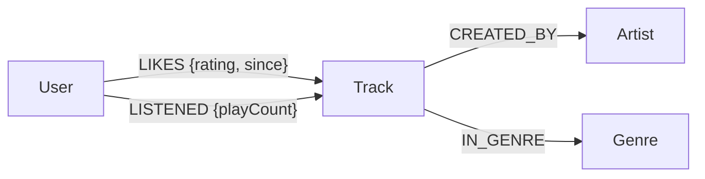

# Graph Model

## Entity-relationship view

## Design notes

- `User`, `Track`, `Artist`, and `Genre` are node labels.
- `userId`, `trackId`, `artistId`, and `genreId` are unique identifiers.
- `LIKES` captures explicit preference and rating.
- `LISTENED` is reserved for future listening-event data.
- `CREATED_BY` connects each track to its artist.
- `IN_GENRE` supports discovery across similar musical styles.

The sample dataset is deliberately small and fictional so the project can be run locally without external data licensing concerns.
