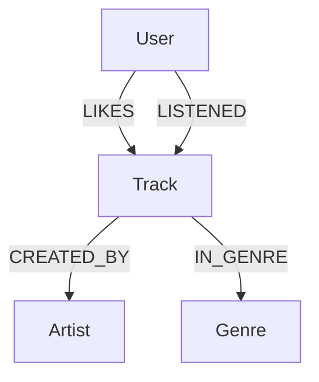

# 🎵 PH Music Graph Recommender

### Music Recommendation System Using Python and Neo4j

[](https://www.python.org/)
[](https://neo4j.com/)
[](https://neo4j.com/developer/cypher/)
[]()

A graph-based music recommendation system developed with **Python, Neo4j, and Cypher**, designed to demonstrate how relationships between users, tracks, artists, and genres can be used to generate personalized music recommendations.

---

## 📌 Project Overview

The **PH Music Graph Recommender** explores the use of graph databases to build a recommendation engine based on relationships and user preferences.

Unlike traditional relational approaches, graph databases make it possible to represent and navigate connections between data entities directly.

In this project, users are connected to the tracks they like, tracks are associated with artists and genres, and these relationships are analyzed to identify potential music recommendations.

The system evaluates shared preferences and connections within the graph to suggest tracks that a user has not previously liked.

## 🎯 Project Objectives

- Understand and apply graph database concepts.
- Model music-related information using nodes and relationships.
- Store and query graph data using Neo4j.
- Import structured datasets using CSV files and Cypher.
- Develop recommendation logic using Python.
- Explore how graph relationships can support personalized recommendations.

## 🧰 Technologies

| Technology | Purpose |
|---|---|
| Python | Recommendation logic and application integration |
| Neo4j | Graph database and relationship management |
| Cypher | Graph creation, data loading, and queries |
| Neo4j Python Driver | Communication between Python and Neo4j |
| CSV | Dataset organization and data import |
| python-dotenv | Environment variable configuration |

## 🏗️ Graph Data Model

The database is organized around four main node types:

- **User:** Represents a music listener.
- **Track:** Represents a music track.
- **Artist:** Represents the artist responsible for a track.
- **Genre:** Represents the musical genre.

### Relationships

| Relationship | Description |
|---|---|
| `LIKES` | Connects a user to a track they like |
| `LISTENED` | Records listening activity |
| `CREATED_BY` | Connects a track to its artist |
| `IN_GENRE` | Connects a track to its genre |

### Graph Structure



### Relationship Properties

The graph also supports relationship properties such as:

- `rating`: User rating associated with a track.
- `since`: Date associated with a user's preference.
- `playCount`: Number of recorded plays.

These properties provide additional information for querying and recommendation analysis.

## 🧠 Recommendation Logic

The recommendation engine analyzes the relationships within the graph to identify tracks that may match a user's musical preferences.

The scoring model considers three factors:

| Recommendation Factor | Score |
|---|---:|
| Shared musical genre | +2 |
| Shared artist | +3 |
| Common listener | +1 |

Tracks already liked by the target user are excluded from the recommendation results.

The resulting score is used to rank candidate tracks.

**Example:**

If a user likes alternative rock tracks and another track shares the same genre and artist connections, that track can receive a higher recommendation score.

This is an educational rule-based recommendation model, not a machine learning system.

## 📂 Project Structure

```text
PH-MUSIC-GRAPH-RECOMMENDER/
│
├── data/
│   ├── users.csv
│   ├── artists.csv
│   ├── genres.csv
│   ├── tracks.csv
│   └── likes.csv
│
├── cypher/
│   ├── 01_constraints.cypher
│   ├── 02_load_data.cypher
│   ├── 03_recommendations.cypher
│   └── 04_business_questions.cypher
│
├── docs/
│   └── graph-model.md
│
├── src/
│   └── recommend.py
│
├── .env.example
├── .gitignore
├── requirements.txt
├── README.md
└── DIO-SUBMISSION.txt
```

## ⚙️ Requirements

Before running the project, make sure you have:

- Python 3.10 or later.
- A Neo4j database instance.
- Neo4j Browser or another compatible Neo4j interface.
- Access to the project files.

A local Neo4j installation or a compatible Neo4j Aura instance can be used, subject to the data import configuration.

## 🚀 Installation and Setup

### 1. Clone the repository

```bash
git clone https://github.com/phsmottanerd/PH-MUSIC-GRAPH-RECOMMENDER.git
```

```bash
cd PH-MUSIC-GRAPH-RECOMMENDER
```

### 2. Create a virtual environment

```bash
python -m venv .venv
```

Activate it on Windows:

```bash
.venv\Scripts\activate
```

On Linux:

```bash
source .venv/bin/activate
```

### 3. Install dependencies

```bash
pip install -r requirements.txt
```

### 4. Configure environment variables

Create a `.env` file based on `.env.example`.

Configure the connection details required by the application:

- Neo4j database URI.
- Database username.
- Database password.
- Database name, if required by the application.

**Security note:** Never commit your real `.env` file or database credentials to GitHub.

### 5. Configure Neo4j and import the dataset

Start your Neo4j database and configure its CSV import directory.

For the local `LOAD CSV` commands, place the CSV files from the `data/` directory into the Neo4j import directory, preserving their filenames.

Then execute the Cypher scripts in the following order using Neo4j Browser:

1. `cypher/01_constraints.cypher`
2. `cypher/02_load_data.cypher`
3. `cypher/03_recommendations.cypher`
4. `cypher/04_business_questions.cypher`

**Note:** Neo4j Aura and other hosted environments may require a different CSV import method, such as an accessible HTTPS URL or another supported import workflow.

### 6. Run the Python application

After configuring the database connection and loading the graph data, execute:

```bash
python src/recommend.py
```

Follow the application instructions to request recommendations for a user.

## 🔎 Cypher Queries and Business Questions

The project includes Cypher scripts to demonstrate graph database operations and answer questions such as:

- Which tracks are associated with a particular user?
- Which artists appear most frequently in user preferences?
- Which musical genres are most represented?
- Which tracks could be recommended based on shared relationships?
- Which candidate tracks have the strongest recommendation scores?

These queries demonstrate how graph traversal and relationship analysis can support recommendation scenarios.

## 📊 Dataset

The project includes sample CSV datasets representing:

- Users
- Artists
- Genres
- Tracks
- User preferences and likes

**All dataset records are fictional and intended for educational and demonstration purposes.**

No real user listening history or personal information is included.

## 🔐 Security and Best Practices

The project follows basic development and security practices:

- Database credentials are configured through environment variables.
- `.env` is excluded from version control.
- Sample configuration is provided through `.env.example`.
- Data is separated from application source code.
- Cypher scripts are organized by purpose.

## 📚 Learning Outcomes

This project demonstrates practical knowledge of:

- Graph database modeling.
- Neo4j fundamentals.
- Cypher query language.
- Node and relationship design.
- CSV data import.
- Python database integration.
- Rule-based recommendation algorithms.
- Data relationship analysis.

## 🔮 Future Improvements

Possible future enhancements include:

- Implementing additional recommendation strategies.
- Adding user interaction and feedback mechanisms.
- Introducing recommendation explanations.
- Developing a web-based interface.
- Evaluating recommendation quality with test datasets.
- Exploring collaborative filtering and machine learning approaches.

## 👨‍💻 Author

**Paulo Henrique Santana Motta**

IT Professional | Java | Linux | Infrastructure | Cybersecurity | Python | Graph Databases

GitHub: [@phsmottanerd](https://github.com/phsmottanerd)

LinkedIn: [Paulo Henrique Santana Motta](https://www.linkedin.com/in/paulo-henrique-santana-motta-52475041a/)

---

## 📄 License

This project is intended for educational and portfolio purposes.

---

**PH Music Graph Recommender — Connecting music preferences through graph relationships.** 🎵
